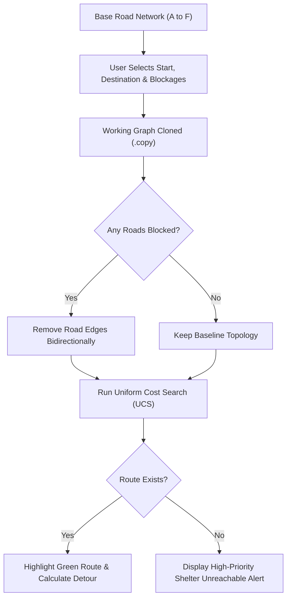

# AI-Based Emergency Evacuation Route Planner
## Presentation Slide Deck Plan (12 Slides)

This presentation plan is designed for an academic project review, college presentation, or viva. It translates the verified technical findings from the codebase into clear, student-friendly slide outlines with speaker notes and visual suggestions.

---

### Slide 1: Title Slide
- **Slide Title**: AI-Based Emergency Evacuation Route Planner
- **Subtitle**: Graph-Theoretic Pathfinding & Dynamic Hazard Rerouting
- **Presenter / Team Name**: [Student Name(s) / Roll Number(s)]
- **Department / Course**: Department of Computer Science & Engineering
- **Academic Year / Date**: 2026
- **Key Visual Elements**:
  - Emergency icon (🚨) or evacuation symbol.
  - Sub-banner: *"An Educational Algorithmic Simulation Using Python, NetworkX, and Streamlit"*.
- **Presenter Talking Points**:
  - *"Good morning/afternoon respected professors and peers. Today, we present our AI-Based Emergency Evacuation Route Planner, an interactive project demonstrating how artificial intelligence graph search algorithms can calculate safe evacuation routes and automatically navigate around dynamic road hazards."*

---

### Slide 2: Introduction
- **Slide Title**: Introduction & Motivation
- **Key Points**:
  - **The Problem in Disasters**: During natural disasters (wildfires, floods, debris), road conditions change by the minute.
  - **Traditional Navigation Gaps**: Standard GPS routing often relies on historical traffic and can lead evacuees directly into blocked or hazard-prone corridors.
  - **Role of AI Search**: Graph search algorithms can evaluate road networks mathematically, finding optimal paths and recalculating safe detours instantly when roads close.
  - **Project Focus**: A self-contained, interactive prototype comparing unweighted vs. weighted AI search techniques with real-time road closure simulation.
- **Presenter Talking Points**:
  - *"In emergencies, every minute counts. Standard consumer navigation apps are designed for normal commutes, not life-threatening disaster zones where entire roads can become impassable without notice. This project explores how AI pathfinding can model road networks and dynamically guide evacuees to safety."*

---

### Slide 3: Problem Statement
- **Slide Title**: The Emergency Evacuation Challenge
- **Key Points**:
  - **1. Dynamic & Unpredictable Closures**: Hazards spread rapidly, requiring bidirectional road blocks (neither direction is passable).
  - **2. The "Hop vs. Distance" Dilemma**: The route with the fewest turns or intersections is frequently **not** the shortest physical travel distance.
  - **3. Network Isolation Risks**: If fires or floods cut off every road to a shelter, the system must detect that the destination is unreachable immediately—avoiding infinite loops or misleading evacuees.
- **Visual Suggestion**:
  - Simple comparison graphic showing a 3-hop long road vs. a 5-hop short road.
- **Presenter Talking Points**:
  - *"When designing an evacuation system, we face three major technical hurdles: handling unpredictable two-way road closures, understanding that fewer turns doesn't always mean a shorter escape route, and safely alerting evacuees when a shelter has become completely cut off."*

---

### Slide 4: Project Objectives
- **Slide Title**: Objectives & Scope
- **Key Points**:
  - **Model a Road Network**: Build a topological graph with intersections (nodes) and distance-weighted roads (edges) using NetworkX.
  - **Algorithm Comparison**: Implement and compare **Breadth-First Search (BFS)**, **Uniform Cost Search (UCS)**, and **A\* Search**.
  - **Simulate Dynamic Road Closures**: Allow users to block road segments and observe automatic real-time rerouting.
  - **Interactive Dashboard**: Build an easy-to-use web interface using Streamlit and Folium with OpenStreetMap visualization.
  - **Fail-Safe Logic**: Gracefully handle edge cases such as disconnected network partitions.
- **Presenter Talking Points**:
  - *"Our goal was not just to write algorithms on paper, but to build an end-to-end working system: modeling the roads, coding three classic AI search algorithms from scratch, testing them under road hazard conditions, and visualizing everything on an interactive map."*

---

### Slide 5: Technologies Used
- **Slide Title**: Technology Stack
- **Architecture Table**:

| Technology | Role in System | Key Advantage |
| :--- | :--- | :--- |
| **Python 3.15** | Core Programming Language | Clean syntax, robust standard library (`heapq`, `collections`). |
| **NetworkX** | Graph Modeling & Simple Paths | Handles topology and `shortest_simple_paths` K-route generation. |
| **OSM Nominatim** | Address Geocoding Engine | Geocodes real streets, landmarks, and shelters with zero API keys. |
| **OSRM Engine** | Real Road Routing Service | Computes true drivable road geometry, distances, and drive times. |
| **Streamlit** | Multi-Route Interactive UI | Reactive UI controls (mode toggles, route highlighting, metric cards). |
| **Folium & OSM** | Geospatial Map Visualization | Embeds interactive Leaflet maps directly with distinct route colors. |

- **Presenter Talking Points**:
  - *"We chose Python for its rich scientific ecosystem. NetworkX represents our graph models; OpenStreetMap Nominatim and OSRM power our real-world address geocoding and road routing; and Streamlit paired with Folium lets us deliver an interactive multi-route dashboard running entirely on free open-source tools with zero API keys."*

---

### Slide 6: System Architecture & Workflow
- **Slide Title**: System Architecture & Execution Workflow
- **Modular Pipeline**:
  - `road_network.py`: Initializes the baseline simulated graph (6 nodes, 9 roads).
  - `route_algorithms.py`: Pure implementations of BFS, UCS, and A* pathfinding.
  - `evacuation_simulator.py`: Manages graph cloning (`.copy()`), closures, and detour math.
  - `real_routing.py`: Connects to Nominatim and OSRM for real address routing.
  - `multi_route_planner.py`: Generates distinct real alternatives, hazard avoidance, and nearest shelter evaluation.
  - `app.py`: Interactive multi-route Streamlit dashboard and Folium map rendering.
- **Workflow Diagram**:

- 📸 **Suggested Screenshot Placement**: 
  - *Insert a screenshot of the main Streamlit web application showing the top metric cards and overall dashboard layout.*
- **Presenter Talking Points**:
  - *"Our code follows a clean, modular structure. The user picks their start point, destination, and any blocked roads. The system clones the graph so the original stays untouched, removes the blocked roads, runs UCS, and either displays the optimal green route or alerts the user if the shelter is cut off."*

---

### Slide 7: Road Network & Graph Representation
- **Slide Title**: Simulated Road Network
- **Graph Topology**:
  - **6 Intersections (Nodes)**: `A` (Start Origin), `B`, `C`, `D`, `E`, `F` (Safe Shelter).
  - **9 Two-Way Road Segments (Edges with Distances)**:
    - Road `A-B`: **4 units** | Road `A-C`: **2 units** | Road `B-C`: **1 unit**
    - Road `B-D`: **5 units** | Road `C-D`: **8 units** | Road `C-E`: **10 units**
    - Road `D-E`: **2 units** | Road `D-F`: **6 units** | Road `E-F`: **3 units**
- **Geographic Representation**:
  - Assigned simulated coordinates across a city grid.
  - Mapped into Folium using interactive markers (Green = Start, Red = Shelter, Blue = Intersections).
- **Presenter Talking Points**:
  - *"Here is our road network. Intersection A is the evacuation origin, and Intersection F is the safe shelter. Notice that roads have different distance values: for example, the direct road from C to E is 10 units, while going through B and D provides shorter individual segments."*

---

### Slide 8: BFS, UCS, and A* Comparison
- **Slide Title**: Algorithm Comparison (A to F)
- **Plain English Concept Comparison**:
  - **BFS (Breadth-First Search)**: Explores layer-by-layer; finds the path with the **fewest intersections (hops)** regardless of road length.
  - **UCS (Uniform Cost Search / Dijkstra)**: Expands the path with the **lowest cumulative distance**; guarantees the true shortest travel route.
  - **A\* Search**: Uses evaluation function $f(n) = g(n) + h(n)$. With an admissible heuristic ($h=0$), it matches UCS optimality.
- **Empirical Results Table**:

| Algorithm | Route Discovered | Total Intersections | Hops | Total Distance | Optimality |
| :--- | :--- | :--- | :--- | :--- | :--- |
| **BFS** | `A -> B -> D -> F` | 4 nodes | **3 hops** | **15 units** | Suboptimal distance (Hop-optimal only) |
| **UCS** | `A -> C -> B -> D -> E -> F` | 6 nodes | **5 hops** | **13 units** | **Globally Optimal Distance** |
| **A\* ($h=0$)** | `A -> C -> B -> D -> E -> F` | 6 nodes | **5 hops** | **13 units** | **Globally Optimal Distance** |

- **Key Takeaway**:
  - *BFS takes only 3 hops, but results in 15 units of travel.*
  - *UCS takes 5 hops across smaller roads, successfully discovering the optimal 13-unit path.*
- **Presenter Talking Points**:
  - *"This slide illustrates the core computer science insight of our project: BFS finds the route with the fewest intersections (only 3 hops), but the total distance is 15 units. In contrast, UCS and A* explore slightly more intersections to find the path that is physically shortest—13 units. In an evacuation, distance and time save lives."*

---

### Slide 9: Dynamic Road Blockage & Rerouting
- **Slide Title**: Hazard Handling & Automatic Rerouting
- **How It Works**:
  - **1. User Selects Closed Roads**: Users flag roads rendered impassable by fire, flooding, or fallen trees.
  - **2. Bidirectional Edge Deletion**: Undirected edge $(u, v)$ is removed, preventing travel from both directions.
  - **3. Instant Rerouting**: UCS is instantly re-executed on the remaining open roads.
  - **4. Detour Quantification**:
    $$\text{Detour} = \text{New Distance} - \text{Original Distance (13 units)}$$
- **Visual Color Scheme**:
  - 🟢 **Green**: Active safe evacuation path.
  - 🔵 **Blue**: Open passable roads.
  - 🔴 **Red Dashed**: Closed / hazardous roads.
- 📸 **Suggested Screenshot Placement**:
  - *Insert a screenshot of the Folium map showing `Road B <--> D` highlighted in dashed red, and the green evacuation route rerouting through `C -> D -> E -> F`.*
- **Presenter Talking Points**:
  - *"When an emergency occurs, users can select any road to block in the sidebar. Our simulator removes that road bidirectionally, immediately re-runs UCS, and renders the updated route in green while marking the blocked road in dashed red. The user immediately sees the detour distance impact."*

---

### Slide 10: Testing Scenarios & Actual Results
- **Slide Title**: Empirical Test Scenarios
- **Summary of Verified Test Runs**:

| Scenario | Road Closure(s) | Evacuation Route | Total Distance | Detour Impact | Status |
| :--- | :--- | :--- | :--- | :--- | :--- |
| **1. Baseline** | None | `A -> C -> B -> D -> E -> F` | **13 units** | 0 units | Optimal baseline |
| **2. Single Block** | `B <--> D` | `A -> C -> D -> E -> F` | **15 units** | +2 units | Successfully rerouted |
| **3. Multi-Block** | `B <--> D` & `C <--> E` | `A -> C -> D -> E -> F` | **15 units** | +2 units | Alternative corridor found |
| **4. Isolation** | `D <--> F` & `E <--> F` | *None* | **$\infty$ (inf)** | N/A | **Alert: Shelter Unreachable** |
| **5. Isolated Node** | Disconnected `Z` | *None* | **$\infty$ (inf)** | N/A | Graceful boundary handling |
| **6. Real Multi-Route** | Janpath Hazard (400m) | Primary / Alt 1 / Alt 2 / Hazard-Avoid | **4.19 km – 5.25 km** | Variable | **5 Real Routes Discovered** |
| **7. K-Shortest Paths** | None (Top 3) | Path 1 (13u) / Path 2 (14u) / Path 3 (14u) | **13 – 14 units** | +1 unit | **NetworkX Simple Paths** |

- 📸 **Suggested Screenshot Placement**:
  - *Insert a screenshot of the multi-route Folium map showing all candidate routes (Green, Blue, Purple, Coral, Teal) on the OpenStreetMap canvas.*
- **Presenter Talking Points**:
  - *"We verified our system across both simulated and real-world test scenarios. In our real-world multi-route test, the system generated 5 distinct drivable routes between Connaught Place and India Gate, including lateral corridors, candidate shelter analysis, and an explicit detour avoiding a simulated 400m hazard zone on Janpath."*

---

### Slide 11: Limitations & Future Enhancements
- **Slide Title**: Limitations & Future Scope
- **Current Limitations**:
  - **Synthetic Road Network**: Uses 6 simulated intersections and coordinates rather than live GPS mapping.
  - **Static Distance Metric**: Edge weights currently represent static distance, without factoring in vehicle traffic speed or road capacity.
  - **Single Evacuee Model**: Routes one origin-destination pair at a time rather than managing large multi-vehicle traffic flow.
- **Future Enhancements**:
  - **1. Real-World Map Integration**: Ingest real city street networks from OpenStreetMap using the `OSMnx` Python library.
  - **2. Live Traffic & Weather**: Integrate real-time API feeds to adjust edge weights dynamically.
  - **3. Multi-Shelter Allocation**: Automatically recommend the closest accessible shelter when the primary shelter is unreachable.
  - **4. Fleet Evacuation Simulation**: Model multi-agent vehicle dispersal to avoid creating artificial traffic jams.
- **Presenter Talking Points**:
  - *"While our prototype effectively demonstrates AI search and rerouting, it has limitations: the coordinates are simulated and roads are currently modeled as either fully open or fully closed. In future work, we plan to connect this logic to live OpenStreetMap data using OSMnx and incorporate multi-shelter optimization."*

---

### Slide 12: Conclusion & Q&A
- **Slide Title**: Conclusion & Project Takeaways
- **Key Takeaways**:
  - **AI Makes a Difference**: Cost-sensitive search (UCS/A*) consistently outperforms naive hop-based search (BFS) for evacuation safety.
  - **Dynamic Adaptability**: Graph models allow instant bidirectional road closures and automated detour calculations.
  - **Interactive Usability**: Combining Streamlit and Folium creates an accessible, clear visualization tool for disaster planning education.
  - **Responsible Prototyping**: Explicit safety warnings and partition handling ensure that theoretical prototypes do not mislead users.
- **Academic Disclaimer**:
  - *This prototype is an educational demonstration developed for computer science coursework and is not certified for real-world emergency use.*
- **Closing**:
  - *"Thank you! We are now open for questions, feedback, or a live demo of the application."*
- **Presenter Talking Points**:
  - *"In conclusion, this project demonstrated how graph theory and AI search algorithms can be brought together into a responsive, visual dashboard. Thank you for your time, and we would be happy to answer any questions or demonstrate the live dashboard."*

---

### Summary Checklist for Presenters
- [ ] Ensure `py -m streamlit run app.py` is running in your terminal before the presentation begins.
- [ ] Have the browser tab open at `http://localhost:8501`.
- [ ] Take screenshots of the baseline route, a blocked road (`B-D`), and the unreachable destination alert for insertion into Slides 6, 9, and 10.
- [ ] Keep the presentation focused on the comparison between BFS (hop-count) and UCS (physical distance).
