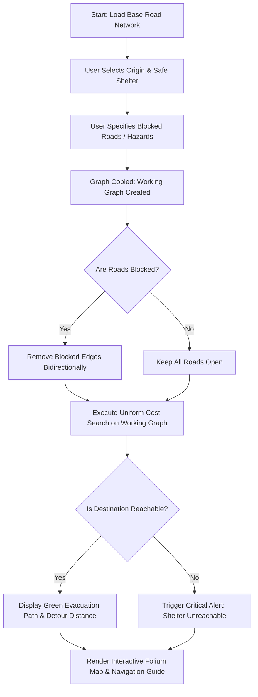

# AI-Based Emergency Evacuation Route Planner
**A Graph-Theoretic Pathfinding and Dynamic Rerouting Prototype**

---

## 1. Abstract
During natural or human-made disasters such as urban fires, flash floods, or infrastructure collapses, conventional navigation systems often fail to adapt rapidly to unpredictable road closures. This project implements a prototype **AI-Based Emergency Evacuation Route Planner** that models road networks as weighted graphs and evaluates optimal evacuation paths using artificial intelligence search algorithms. 

The system compares three foundational graph search algorithms: **Breadth-First Search (BFS)**, **Uniform Cost Search (UCS / Dijkstra)**, and **A\* Search**. Furthermore, it incorporates dynamic road hazard management to simulate real-time road blockages, automatic rerouting, and detour cost analysis. Built with **Python**, **NetworkX**, **Folium**, and **Streamlit**, the application provides both command-line simulation capabilities and an interactive web dashboard with geospatial map visualization.

> **Academic Disclaimer**: This project is an educational and algorithmic prototype developed with simulated network coordinates and synthetic distance weights. It is intended for computer science coursework and demonstrations, and is **not** validated for real-world emergency deployment.

---

## 2. Problem Statement
Emergency evacuation routing presents distinct challenges compared to everyday commercial navigation:
1. **Dynamic Road Closures**: Rapid hazard spread (fire lines, fallen trees, flooding) can render primary roads suddenly impassable in both directions.
2. **Hop vs. Distance Trade-off**: The path with the fewest intersections is not necessarily the shortest physical distance. Minimizing physical travel distance or time is crucial to safely reaching evacuation shelters.
3. **Severe Isolation Scenarios**: If all access corridors to a shelter are compromised, navigation systems must explicitly detect when a destination is unreachable rather than entering infinite loops or returning invalid routes.

---

## 3. Objectives
- **Graph Modeling**: Model a simulated road network with intersections (nodes) and bidirectional roads with distance weights (edges) using NetworkX.
- **Algorithm Implementation & Comparison**: Implement and contrast BFS (unweighted), UCS (weighted/optimal distance), and A* (heuristic search) from scratch.
- **Dynamic Road-Blockage & Rerouting**: Enable users to block one or more road segments bidirectionally and automatically compute alternative shortest-distance evacuation corridors.
- **Interactive Visualization**: Develop an intuitive, beginner-friendly web dashboard using Streamlit and Folium (OpenStreetMap) showing color-coded evacuation routes, normal roads, and hazard blockages.
- **Robust Exception Handling**: Detect and gracefully report unreachable destinations when network partitions occur.

---

## 4. Technologies Used

| Technology | Purpose in Project |
| :--- | :--- |
| **Python (3.15)** | Core programming language for algorithm implementation and system logic. |
| **NetworkX** | Graph-theoretic data structure library used for graph topology and `shortest_simple_paths` k-route evaluation. |
| **Heapq & Collections** | Python standard libraries used to build priority queues (UCS, A*) and FIFO queues (BFS). |
| **Streamlit** | Rapid frontend framework providing the interactive user controls, multi-route selection, metrics, and reactive layout. |
| **Folium & Streamlit-Folium** | Leaflet.js-based geospatial visualization using free **OpenStreetMap** tiles (`tile.openstreetmap.org`) with proper attribution. |
| **OSM Nominatim & OSRM** | Free, open-source geocoding and real-world road graph routing engine requiring zero API keys. |
| **Browser Geolocation API** | User-triggered location capture through a local Streamlit custom component; no location request occurs until the browser button is pressed. |
| **Open-Meteo Weather & Flood APIs** | Selected-location weather and GloFAS-derived daily river-discharge forecasts for advisory indicators; no API key is used by this educational prototype. |

---

## 5. System Architecture and Workflow

### Modular File Structure
The project is structured into modular components to preserve code cleanliness and facilitate independent testing:

- [road_network.py](file:///C:/Users/bhavy/OneDrive/Desktop/ai/road_network.py): Defines the base simulated graph topology (6 intersections `A` through `F` and 9 weighted bidirectional road segments).
- [route_algorithms.py](file:///C:/Users/bhavy/OneDrive/Desktop/ai/route_algorithms.py): Contains pure algorithm implementations for BFS, UCS, and A*, along with path distance calculation helpers and unreachable node tests.
- [evacuation_simulator.py](file:///C:/Users/bhavy/OneDrive/Desktop/ai/evacuation_simulator.py): Manages isolated graph copies (`.copy()`), applies bidirectional edge closures, and calculates before-and-after detour metrics.
- [real_routing.py](file:///C:/Users/bhavy/OneDrive/Desktop/ai/real_routing.py): Integrates OpenStreetMap Nominatim for address geocoding and OSRM for real-world road graph routing.
- [multi_route_planner.py](file:///C:/Users/bhavy/OneDrive/Desktop/ai/multi_route_planner.py): Generates multiple distinct real-world routes (Primary, Alternatives, Hazard Avoidance, Nearest Shelter) and NetworkX K-shortest simple paths on graphs.
- [weather_service.py](file:///C:/Users/bhavy/OneDrive/Desktop/ai/weather_service.py): Retrieves Open-Meteo weather forecast values separately from route calculations.
- [emergency_monitor.py](file:///C:/Users/bhavy/OneDrive/Desktop/ai/emergency_monitor.py): Retrieves Open-Meteo Flood API discharge forecasts and evaluates a configurable, non-validated rainfall screening indicator.
- [disaster_alert_service.py](file:///C:/Users/bhavy/OneDrive/Desktop/ai/disaster_alert_service.py): Manually retrieves location-wise alerts from the NDMA SACHET portal and compares supplied GeoJSON polygons with selected points and real-world route geometries.
- [location_component/index.html](file:///C:/Users/bhavy/OneDrive/Desktop/ai/location_component/index.html): User-clicked browser geolocation component using Streamlit's declared custom-component protocol.
- [app.py](file:///C:/Users/bhavy/OneDrive/Desktop/ai/app.py): The interactive multi-route Streamlit and Folium dashboard with manual/live starting-point selection, route highlighting, browser-side voice navigation, and safety warnings.

### System Workflow Diagram

---

## 6. Pathfinding Algorithms Explained

### 1. Breadth-First Search (BFS)
- **Concept**: Explores nodes layer-by-layer using a First-In, First-Out (FIFO) queue (`collections.deque`).
- **Characteristics**: Unweighted search. It treats every road segment as having an identical cost of $1$ hop.
- **Behavior**: Finds the route with the **fewest intersections (hops)**, completely ignoring physical distance.

### 2. Uniform Cost Search (UCS / Dijkstra's Algorithm)
- **Concept**: Explores paths in order of increasing cumulative road distance $g(n)$ using a priority queue (`heapq`).
- **Characteristics**: Weighted, cost-sensitive search.
- **Behavior**: Always expands the cheapest cumulative path first. Guarantees the **globally optimal (shortest physical distance)** route in graphs with non-negative edge weights.

### 3. A\* Search
- **Concept**: An informed search algorithm that expands nodes based on an evaluation function:
  $$f(n) = g(n) + h(n)$$
  where $g(n)$ is the exact distance traveled from the start to node $n$, and $h(n)$ is a heuristic estimate of the remaining distance to the goal.
- **Admissibility**: A heuristic is *admissible* if it never overestimates the actual cost to the destination ($h(n) \le h^*(n)$).
- **Project Heuristic Choice**: Because our simulated network uses arbitrary synthetic distances without fixed Cartesian geometry, an admissible heuristic of zero ($h(n) = 0$) is applied. This ensures $f(n) = g(n)$, making A* behave identically to UCS while remaining fully admissible and optimal.

---

## 7. Dynamic Road-Blockage Simulation & Rerouting

In real-world disasters, roads become blocked due to flooding, fire, or debris. The project handles this through the following engineering principles:

1. **Non-Destructive Graph Copies**: Before applying closures, the system clones the baseline graph via `base_graph.copy()`. This guarantees that consecutive simulation runs remain 100% independent.
2. **Bidirectional Closure**: Because the graph is undirected (`nx.Graph`), executing `working_graph.remove_edge(u, v)` immediately closes travel in both directions (`u -> v` and `v -> u`).
3. **Automated Rerouting**: UCS is re-executed on the updated topology. If viable alternative roads exist, the optimal detour is returned; if not, an unreachable state is identified.
4. **Detour Metric**:
   $$\text{Detour} = \text{Distance}_{\text{Active}} - \text{Distance}_{\text{Baseline}}$$

---

## 8. Testing Scenarios and Empirical Results

The simulated network consists of 6 intersections (`A, B, C, D, E, F`) and 9 bidirectional roads:
- `A-B (4)`, `A-C (2)`, `B-C (1)`, `B-D (5)`, `C-D (8)`, `C-E (10)`, `D-E (2)`, `D-F (6)`, `E-F (3)`
- Origin: **Intersection A**
- Destination: **Shelter F**

### Test Scenario 1: Baseline Algorithm Comparison (No Blockages)
Evaluates how BFS, UCS, and A* navigate from `A` to `F`:

| Algorithm | Route Taken | Intersections (Hops) | Total Distance | Outcome |
| :--- | :--- | :--- | :--- | :--- |
| **BFS** | `A -> B -> D -> F` | 4 nodes (3 hops) | **15 units** | Fewest intersections, but longer distance. |
| **UCS** | `A -> C -> B -> D -> E -> F` | 6 nodes (5 hops) | **13 units** | Optimal shortest physical distance. |
| **A\* ($h=0$)** | `A -> C -> B -> D -> E -> F` | 6 nodes (5 hops) | **13 units** | Matches UCS (optimal). |

> **Key Observation**: BFS selects the route with only 3 hops, but incurs 15 distance units. UCS traverses 5 hops across shorter road links, successfully identifying the true minimum distance of 13 units.

---

### Test Scenario 2: Single Road Blockage (`B <--> D`)
- **Hazard**: Major road between `B` and `D` is closed.
- **Original Route**: `A -> C -> B -> D -> E -> F` (13 units).
- **Rerouted Path**: `A -> C -> D -> E -> F`.
- **New Distance**: **15 units** (Detour: `+2 units`).
- **Result**: System successfully bypasses the hazard and discovers the next shortest route.

---

### Test Scenario 3: Multiple Road Blockages (`B <--> D` and `C <--> E`)
- **Hazards**: Two major corridors are simultaneously compromised.
- **Rerouted Path**: `A -> C -> D -> E -> F`.
- **New Distance**: **15 units** (Detour: `+2 units`).
- **Result**: The algorithm automatically maneuvers through the remaining open corridor `C -> D`.

---

### Test Scenario 4: Critical Isolation / Unreachable Destination
- **Hazards**: Both entrance corridors to shelter `F` (`D <--> F` and `E <--> F`) are blocked.
- **Result**:
  - `uniform_cost_search()` returns `(None, inf)`.
  - Terminal output: `DESTINATION UNREACHABLE! All evacuation paths to the shelter are cut off.`
  - Streamlit UI: Displays a high-priority red alert warning evacuees to shelter in place.

---

### Test Scenario 5: Disconnected Node Unit Test (`route_algorithms.py`)
- **Edge Case**: An isolated node `Z` with zero connecting roads is introduced into the graph.
- **Evaluated Query**: Origin `A` to Isolated Shelter `Z`.
- **Empirical Output**:
  - **BFS Result**: `Route = None`, `Distance = inf`
  - **UCS Result**: `Route = None`, `Distance = inf`
  - **A\* Result**: `Route = None`, `Distance = inf`
- **Result**: Confirms all search algorithms handle disconnected graph partitions gracefully without crashing or entering infinite loops.

---

### Test Scenario 6: Real-World Multi-Route Generation (OpenStreetMap & OSRM)
- **Origin**: `"Connaught Place, New Delhi"` (`28.63177, 77.21938`)
- **Destination**: `"India Gate, New Delhi"` (`28.61293, 77.22949`)
- **Simulated Hazard**: `"Janpath, New Delhi"` (Buffer: 400m)
- **Candidate Shelter**: `"Major Dhyan Chand National Stadium"` (`28.6119, 77.2374`)
- **Empirical Multi-Route Results**:
  - **Primary Route (Green)**: 4.19 km (5.5 min) — Shortest physical road distance.
  - **Alternative Route 1 (Blue)**: 5.25 km (8.5 min) — Dispersal via parallel arterial corridor.
  - **Alternative Route 2 (Purple)**: 5.08 km (7.4 min) — Secondary lateral bypass corridor.
  - **Hazard-Bypassing Route (Coral)**: 5.25 km (8.5 min) — Actively routed outside the 400m Janpath hazard zone.
  - **Nearest Shelter Route (Teal)**: 4.62 km (6.8 min) — Direct road route to candidate stadium shelter.
- **Result**: Successfully generated 5 distinct, non-overlapping drivable paths along actual OpenStreetMap roads.

---

### Test Scenario 7: Simulated K-Shortest Simple Paths (NetworkX on A -> F)
- **Algorithm**: `networkx.shortest_simple_paths` on unblocked base graph:
  - **Path 1**: `A -> C -> B -> D -> E -> F` | **13 units** (5 hops) — Globally optimal.
  - **Path 2**: `A -> B -> D -> E -> F` | **14 units** (4 hops) — Alternative corridor (+1 unit).
  - **Path 3**: `A -> C -> B -> D -> F` | **14 units** (4 hops) — Alternative corridor (+1 unit).
- **With Blocked Roads (`B-D` and `C-E`)**:
  - **Rerouted 1**: `A -> C -> D -> E -> F` | **15 units**
  - **Rerouted 2**: `A -> C -> D -> F` | **16 units**
- **Result**: Verifies that alternative paths are dynamically discovered without duplicate fabrication.

---

## 9. Current Limitations
1. **Simulated Synthetic Coordinates**: The 6 intersections use mock coordinates for visual rendering on OpenStreetMap rather than surveyed GPS data.
2. **Static Distance Metric**: Edge weights represent static spatial distance only; they do not yet incorporate dynamic variables like vehicle congestion, road capacity, or travel speed.
3. **Single Evacuation Target**: The system calculates a route between one origin and one destination at a time, rather than coordinating multi-agent fleet evacuations.
4. **Binary Road States**: Road segments are currently modeled as either 100% open or 100% closed, without intermediate states such as slow-moving traffic or partial lane closures.
5. **No Real-World Safety Guarantees**: The application makes no claims of physical safety, compliance with emergency protocols, or real-time situational awareness.
6. **Experimental Voice Navigation**: Browser SpeechSynthesis reads route instructions without a paid voice service. Live GPS is optional and only advances instructions when an accurate fix is near the route; otherwise navigation is explicitly manual/demo. GPS quality, browser support, and routing instructions are not guaranteed.
7. **Browser Location and OSM Service Limits**: Browser geolocation requires user permission and a secure context (HTTPS or localhost). A live start point is sent to Nominatim for optional reverse geocoding; the app throttles Nominatim requests to at most one per second. Address lookups run only when a route is explicitly requested, and successful geocoding results are cached for one hour. Nominatim uses an app-identifying User-Agent; set the optional `NOMINATIM_CONTACT` environment variable to a real project contact. Configure the request timeout with `NOMINATIM_TIMEOUT_SECONDS` (default: 8 seconds). One transient timeout, connection failure, or server error is retried once; failed lookups are not cached. If destination lookup fails, edit the place name or retry the route request; the app does not substitute another destination.
8. **Forecast Indicators Are Not Official Warnings**: The optional monitor requests Open-Meteo hourly weather and daily river-discharge forecasts for selected real-world coordinates. The flood endpoint uses GloFAS-derived data and returns discharge for a nearby river on an approximately 5 km grid; the closest river may not be the relevant one. The dashboard labels saved weather responses with their retrieval time and flags reports older than 30 minutes; the explicit weather request clears the Streamlit response cache before fetching. The default 10 mm/hour rain trigger is an AEGIS screening setting, not a DHM threshold or locally validated flash-flood threshold. River discharge is displayed without a danger threshold. Forecast-based indicators remain separate from official warning records and do not establish that an area is safe. Open-Meteo free API use is subject to its non-commercial-use limits, attribution, and CC BY 4.0 terms.
9. **Official Alert Source and Coverage**: The real-world dashboard uses the NDMA SACHET portal's `FetchLocationWiseAlerts` location endpoint for a 20 km search around the selected origin and destination. A live request returned HTTP 200 with a JSON response; the observed response contained an empty alert list, not a fabricated or demonstration alert. The portal frontend exposes this endpoint and returns alert fields and source GeoJSON polygons, but standalone developer API documentation, stability guarantees, and usage guidance were not verified. No API key was observed or required in the tested request. Successful reports are cached for five minutes, marked stale after 30 minutes, and failed requests are not cached. The shared **Refresh Emergency Data** control refreshes weather, flood, and SACHET reports; optional scheduled refresh remains limited to forecast data. Alert validity is classified as active, scheduled, expired, unknown, stale, or no matching alerts. Active point/route applicability is evaluated only when valid source polygons are supplied. Route intersections are geometric comparisons against returned alert areas, not verified closures or safety conclusions; the portal search radius around selected locations does not necessarily cover the full route corridor.
10. **IMD and Other Official Feeds**: No documented, machine-readable public alert API or feed from IMD, Nepal DHM, or a state disaster-management authority was verified for integration. AEGIS does not scrape those pages or claim those sources are connected. This prototype does not provide comprehensive national warnings, official instructions, source confidence, or validated Warning/Critical classifications. An unavailable source, an empty result, an expired record, or an alert with unknown validity is not evidence of safety.

> **Safety notice**: This educational prototype is not a certified life-safety or emergency-navigation system. Forecast indicators are not official warnings, measured local conditions, or validated hazard probabilities. It does not provide verified safety, live traffic, or independently verified hazard detection. Always follow current official emergency instructions and local authorities.

---

## 10. Future Enhancements
- **Dynamic Cost Functions**: Incorporate time-dependent edge weights factoring in real-time congestion, road gradient, and weather conditions.
- **Multi-Shelter Optimization**: Automatically evaluate multiple designated safe shelters and direct evacuees to the nearest accessible location.
- **Real-World Geographic Ingestion**: Integrate OpenStreetMap APIs (such as `OSMnx`) to download and route across real city road networks with genuine GPS coordinates.
- **Multi-Agent Simulation**: Simulate hundreds of evacuating vehicles concurrently to analyze bottleneck formation and optimize traffic dispersal.

---

## 11. Conclusion
This project successfully demonstrates the application of AI pathfinding techniques to emergency evacuation planning. By contrasting unweighted (BFS) and weighted (UCS, A*) search algorithms, it highlights why cost-sensitive graph search is essential in life-critical navigation. The integration of dynamic road blockages, automatic rerouting, and an interactive Streamlit-Folium dashboard provides an accessible, educational tool demonstrating how computational graph theory can support disaster response decision-making.
